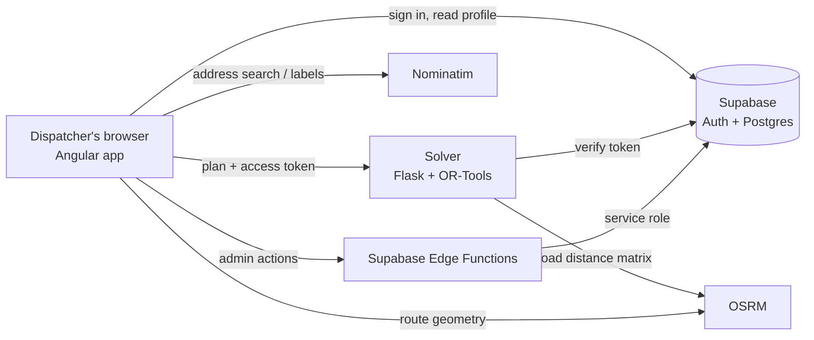

# Waymark

**Delivery route planning for dispatchers and small fleets.**
Place a depot and your stops on a map, describe your vehicles, and Waymark works out which vehicle
goes where and in what order, then draws every route on real roads.

Routes are optimised with [Google OR-Tools](https://developers.google.com/optimization/routing) on real road
distances from [OSRM](https://project-osrm.org/). Accounts and data live in [Supabase](https://supabase.com/).

---

## Contents

- [Features](#features)
- [Routing problems](#routing-problems)
- [How it works](#how-it-works)
- [Repository layout](#repository-layout)
- [Getting started](#getting-started)
- [Configuration](#configuration)
- [Testing](#testing)
- [Deployment](#deployment)
- [Security model](#security-model)
- [Limits and known constraints](#limits-and-known-constraints)

> 🇫🇷 New to routing? Read [**Comment marche le solveur**](docs/comment-ca-marche.md), a step-by-step
> explanation in French of the problems, the data the solver receives and what it returns.

---

## Features

**Planning**
- Add stops by clicking the map, searching an address, or importing a CSV. The first stop is the depot.
- Numbered, draggable markers. Right-click a marker to remove it; make any stop the depot.
- Stops placed on the map get their street name filled in automatically.
- Switch between problem types at any time without losing your stops. Your plan is saved in the browser.
- One-click sample plan (11 deliveries around Casablanca) to try things out.

**Results**
- Every route drawn on real roads, one colour per vehicle, with a printed-map style legend.
- Totals (distance, drive time, stops, vehicles used) and per-vehicle breakdowns.
- Capacity bars for capacitated plans; arrival time next to each delivery window for time-window plans.
- Focus a single route, hide routes, export the stop order (with arrival times) as CSV.

**Map**
- Five base maps: Light, Dark, Streets, Terrain, Satellite (or follow the app theme).
- Zoom, fit-all-stops and locate-me controls. Works on desktop and mobile.

**Accounts**
- Email and password sign-up and login, account settings, password change, account deletion.
- Admin area to add, edit and remove users and assign roles.
- Light ("survey sheet") and dark ("chart night") themes.

---

## Routing problems

| Problem | What it solves | You provide |
|---|---|---|
| **TSP** (Travelling Salesman) | One vehicle visits every stop once and returns to the depot. | Stops |
| **VRP** (Vehicle Routing) | Several vehicles share the stops, balancing route lengths. | Stops, number of vehicles |
| **CVRP** (Capacitated VRP) | Vehicles carry limited loads; each stop needs a quantity. | Stops, units per stop, capacity per vehicle |
| **VRPTW** (VRP with Time Windows) | Each stop must be reached within its delivery window. | Stops, vehicles, window per stop (HH:MM), minutes spent at each stop |

---

## How it works



1. **Sign in.** The browser authenticates with Supabase. A database trigger creates a profile
   (`email`, `role`) for every new user.
2. **Plan.** The planner keeps stops, fleet settings and windows locally until you press **Solve**.
3. **Solve.** The browser sends the plan to the solver with the user's Supabase access token. The solver
   asks Supabase to verify the token, validates every field, builds a road distance/time matrix with OSRM,
   and runs one OR-Tools model configured for the chosen problem.
4. **Draw.** The browser requests each route's road geometry from OSRM and draws it on the map.

---

## Repository layout

```
waymark/
├── web/                     Angular 22 single-page app
│   ├── src/app/core/        auth, Supabase client, guards, models
│   ├── src/app/features/    landing, auth, home, solver (planner), profile, admin
│   ├── src/app/shared/      icons, contour graphics, utilities (CSV, geo)
│   ├── DESIGN.md            design system: palette, type, components
│   └── README.md            frontend architecture and conventions
├── solver/                  Flask + OR-Tools routing API
│   ├── server.py            HTTP endpoints
│   ├── validation.py        request validation
│   ├── matrix.py            OSRM road matrix with straight-line fallback
│   ├── solver.py            one OR-Tools model for all four problems
│   ├── auth.py              Supabase token check and rate limit
│   ├── tests/               unit and API tests
│   └── README.md            API reference
├── docs/
│   └── comment-ca-marche.md how the solver works, explained simply (French)
├── supabase/                backend definition
│   ├── migrations/          tables, triggers, Row Level Security
│   └── functions/           admin-users, delete-account Edge Functions
└── README.md
```

---

## Getting started

### Prerequisites

- Node.js 20+ and npm
- Python 3.11+
- A Supabase project (free tier is fine)

### 1. Set up Supabase

```bash
npx supabase login
npx supabase link --project-ref <your-project-ref>
npx supabase db push                          # creates tables, triggers and access rules
npx supabase functions deploy admin-users
npx supabase functions deploy delete-account
npx supabase secrets set ALLOWED_ORIGIN=http://localhost:4200
```

In the Supabase dashboard, under **Authentication → URL Configuration**, set the Site URL to
`http://localhost:4200` (used in confirmation emails).

### 2. Run the solver

```bash
cd solver
python3 -m venv venv
venv/bin/pip install -r requirements.txt
cp .env.example .env              # fill in SUPABASE_URL and SUPABASE_ANON_KEY (publishable key)
set -a && . ./.env && set +a
venv/bin/python server.py         # http://127.0.0.1:5000  (GET /health to check)
```

### 3. Run the web app

In `web/src/environments/environment.development.ts`, set `supabaseUrl` and `supabaseAnonKey` to your
project's URL and publishable key, then:

```bash
cd web
npm install
npm start                         # http://localhost:4200
```

### 4. Make yourself an admin

Sign up in the app, then run this in the Supabase SQL editor:

```sql
update public.profiles set role = 'Admin' where email = 'you@example.com';
```

---

## Configuration

### Web (`web/src/environments/environment*.ts`)

| Key | Purpose |
|---|---|
| `supabaseUrl`, `supabaseAnonKey` | Supabase project URL and **publishable** key (safe in the browser) |
| `solverUrl` | Where the solver API is served |
| `osrmUrl` | Road geometry for drawing routes |
| `geocoderUrl` | Address search and street-name labels (Nominatim) |

### Solver (`solver/.env`)

| Variable | Default | Purpose |
|---|---|---|
| `SUPABASE_URL`, `SUPABASE_ANON_KEY` | required | Used to verify users' access tokens |
| `ALLOWED_ORIGINS` | `http://localhost:4200` | Comma-separated origins allowed by CORS |
| `OSRM_URL` | public OSRM demo | Road distance matrix |
| `OSRM_MAX_LOCATIONS` | `100` | Above this, straight-line estimates are used |
| `MAX_LOCATIONS` | `150` | Largest plan accepted |
| `SOLVES_PER_MINUTE` | `20` | Per-user rate limit |
| `FLASK_DEBUG` | `0` | Never enable on a public interface |

### Edge Functions (`npx supabase secrets set …`)

| Variable | Purpose |
|---|---|
| `ALLOWED_ORIGIN` | Origin allowed to call the functions |

---

## Testing

```bash
cd web && npm test                                                # Vitest
cd solver && venv/bin/python -m unittest discover -s tests -t .   # validation, solver, API
```

The solver tests cover input validation, all four problem types, capacity and time-window constraints,
infeasible plans, authentication, rate limiting and the response format.

---

## Deployment

- **Web:** `npm run build` produces static files in `web/dist/waymark/browser`. Serve them from any static
  host (Netlify, Vercel, Cloudflare Pages, nginx) with a fallback to `index.html` for client-side routes.
  Set `solverUrl` in `environment.ts` to your solver's public URL first.
- **Solver:** run behind a reverse proxy with HTTPS:
  `venv/bin/gunicorn -c gunicorn.conf.py server:app` (see `solver/gunicorn.conf.py`). Set
  `ALLOWED_ORIGINS` to your web app's domain.
- **Supabase:** add your production domain to the auth redirect URLs and set `ALLOWED_ORIGIN` for the
  Edge Functions.

---

## Security model

- **Passwords and sessions** are handled by Supabase Auth; the app never stores passwords.
- **Row Level Security:** users can read only their own profile; admins can read all. Browsers have no
  write access to any table, so nobody can promote themselves to admin.
- **Privileged actions** (creating, editing or deleting other users) run server-side in Edge Functions
  with the service-role key, which never reaches the browser.
- **The solver** accepts only requests carrying a valid Supabase access token, validates every input,
  limits plan size and request rate, and never runs Flask's debugger.
- The Supabase **publishable** key in the web app is designed to be public. Keep the **secret** key out
  of the repository.

---

## Limits and known constraints

- The public OSRM and Nominatim servers are for light use (Nominatim allows one request per second). For
  production traffic, point `OSRM_URL` / `osrmUrl` and `geocoderUrl` at your own or a commercial instance.
- Plans are capped at 150 locations and 50 vehicles.
- Time windows cover a single day (00:00–24:00).
- When OSRM is unreachable, the solver falls back to straight-line estimates; the app says so in the
  results.
